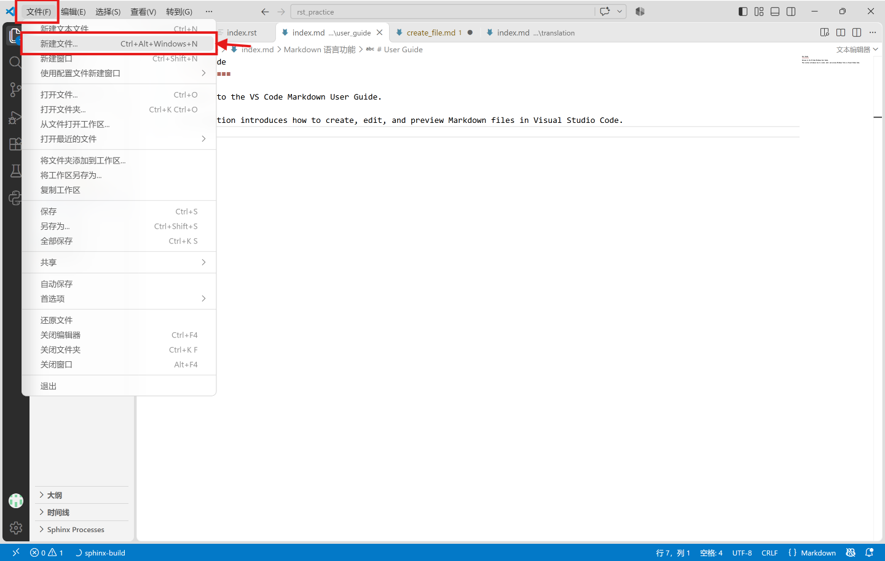
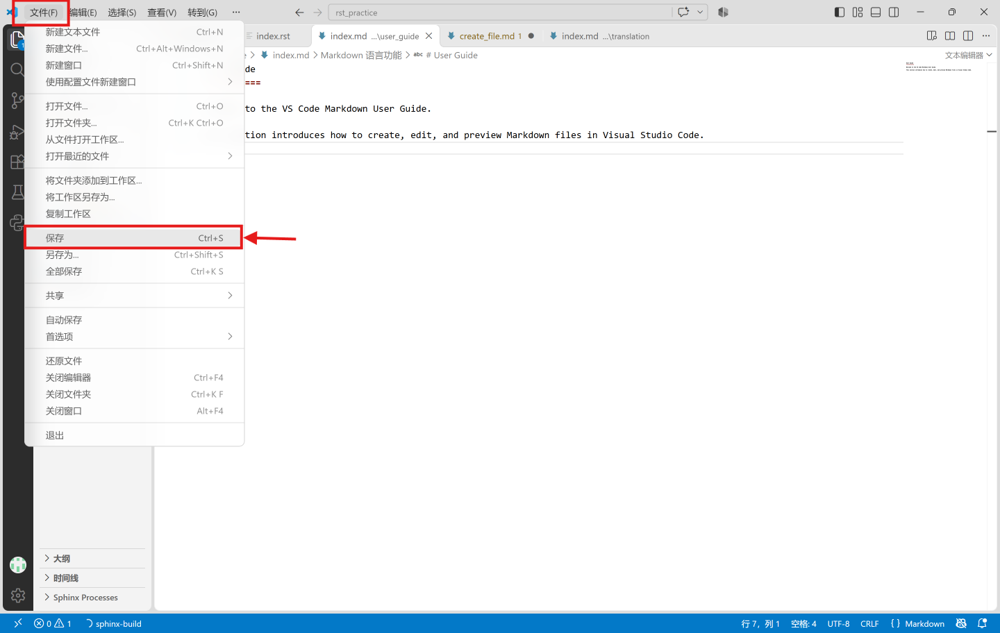

# 创建 Markdown 文件

## 1. 功能简介

Markdown 是一种轻量级标记语言，用户可以通过简单的标记语法组织文本内容。

Visual Studio Code (以下简称 VS Code)支持 Markdown 文件的创建与编辑。本节将介绍如何在 VS Code 中创建一个 Markdown 文件。

## 2. 操作步骤

### 步骤 1：打开 VS Code

启动 VS Code，进入编辑器主界面。

### 步骤 2：创建新文件

在顶部菜单栏中选择：

**File (文件) > New Text File (新建文本文件)**

也可以使用快捷键 Ctrl + N 创建新文件。

<small>图 1：通过 VS Code 顶部菜单栏创建新的文本文件。</small>

### 步骤 3：保存文件

选择：

**File (文件) > Save (保存)**

在文件保存对话框中：

1. 选择文件保存位置。
2. 在文件名输入框中输入你的文件名，例如 `practice.md`。
3. 确认文件扩展名为 `.md`。
4. 点击保存。

<small>图 2：在保存对话框中输入文件名，并使用 .md 扩展名保存文件。</small>

### 步骤 4：确认文件创建成功

保存完成后，文件将显示在 VS Code 编辑器中。

检查文件名是否为之前的命名，例如`practice.md`，并确认文件扩展名为 `.md`。

## 3. 注意事项

- 为保证兼容性，建议使用英文、数字或下划线命名文件名，尽量避免特殊符号。
- Markdown 文件通常使用 `.md` 作为文件扩展名。
- 如果文件扩展名为 `.txt`，则需要重新检查保存时输入的文件名。
- 保存文件时，应选择合适的存储位置，方便后续查找和管理。

## 4. 本节小结

通过以上步骤，用户可以在 VS Code 中创建并保存一个 Markdown 文件，为后续编辑和预览 Markdown 内容做好准备。
