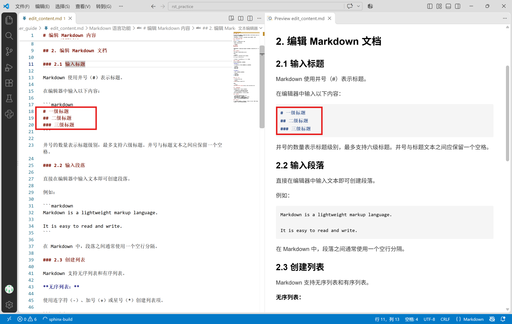
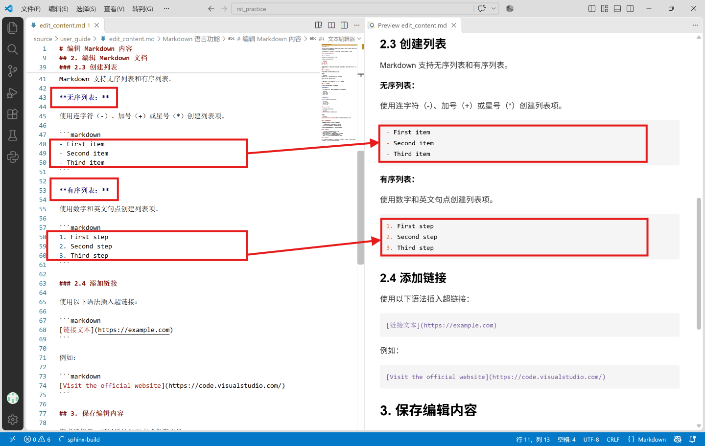
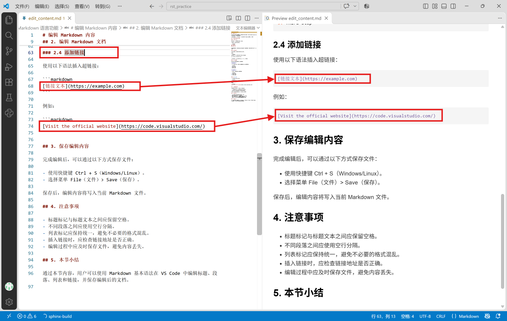
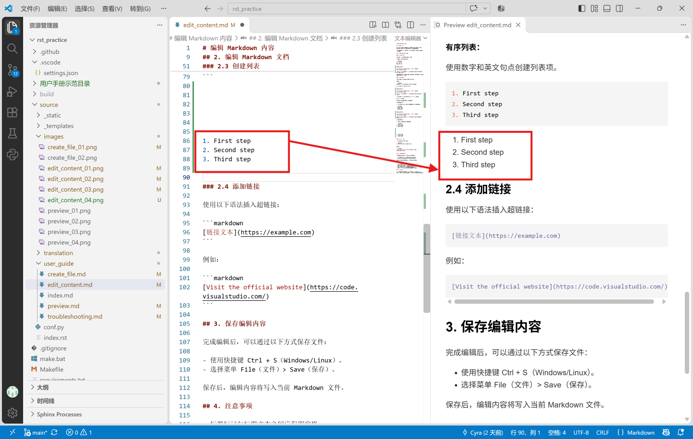
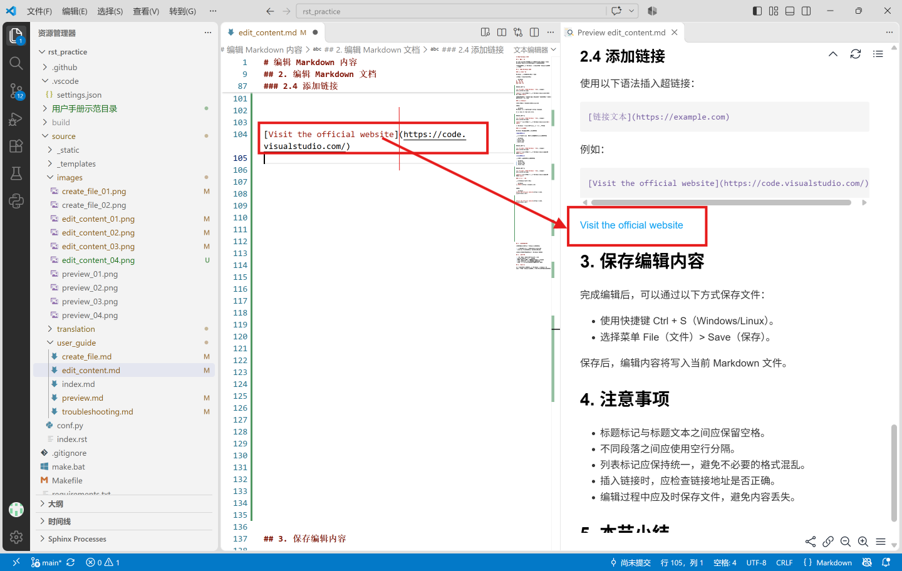
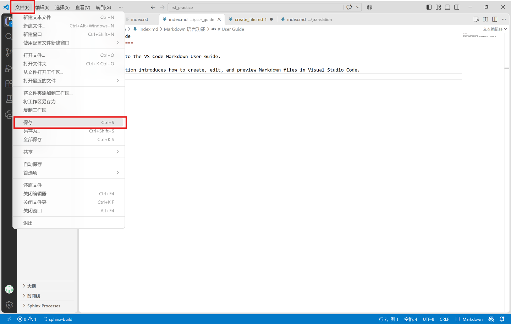

# 编辑 Markdown 内容

## 1. 功能简介

VS Code 提供文本编辑功能，用户可以直接在编辑器中输入 Markdown 语法，创建结构清晰、格式规范的文档。

本节介绍如何使用 Markdown 基本语法编辑标题、段落、列表和链接。

---

## 2. 编辑 Markdown 文档

### 2.1 输入标题

Markdown 使用井号 (#) 表示标题。

在编辑器中输入以下内容：

```markdown
# 一级标题
## 二级标题
### 三级标题
```

渲染效果如图：



<small>图 1：在编辑器中使用 Markdown 语法创建不同级别的标题。</small>

井号的数量表示标题级别，最多支持六级标题。井号与标题文本之间应保留一个空格。

### 2.2 输入段落

直接在编辑器中输入文本即可创建段落。

例如：

```markdown
Markdown is a lightweight markup language.

It is easy to read and write.
```

渲染效果如图：



<small>图 2：在编辑器中使用 Markdown 语法创建段落。</small>

在 Markdown 中，段落之间通常使用一个空行分隔。

### 2.3 创建列表

Markdown 支持无序列表和有序列表。

**无序列表：**

使用连字符 (-) 、加号 (+) 或星号 (*) 创建列表项。

```markdown
- First item
- Second item
- Third item
```

渲染效果如图：



<small>图 3：在编辑器中使用 Markdown 语法创建无序列表。</small>

**有序列表：**

使用数字和英文句点创建列表项。

```markdown
1. First step
2. Second step
3. Third step
```

渲染效果如图：



<small>图 4：在编辑器中使用 Markdown 语法创建无序列表。</small>

### 2.4 添加链接

使用以下语法插入超链接：

```markdown
[链接文本](https://example.com)
```

例如：

```markdown
[Visit the official website](https://code.visualstudio.com/)
```

渲染效果如图：



<small>图 5：在编辑器中使用 Markdown 语法添加超链接。</small>

---

## 3. 保存编辑内容

完成编辑后，可以通过以下方式保存文件：

-**File (文件)  > Save (保存)**

- 使用快捷键 Ctrl + S (Windows/Linux) 

保存后，编辑内容将写入当前 Markdown 文件。



<small>图 6：通过 VS Code 顶部菜单栏保存文本文件。</small>

---

## 4. 注意事项

- 标题标记与标题文本之间应保留空格。
- 不同段落之间应使用空行分隔。
- 列表标记应保持统一，避免不必要的格式混乱。
- 插入链接时，应检查链接地址是否正确。
- 编辑过程中应及时保存文件，避免内容丢失。

---

## 5. 本节小结

通过本节内容，用户可以使用 Markdown 基本语法在 VS Code 中编辑标题、段落、列表和链接，并保存编辑后的文档。
