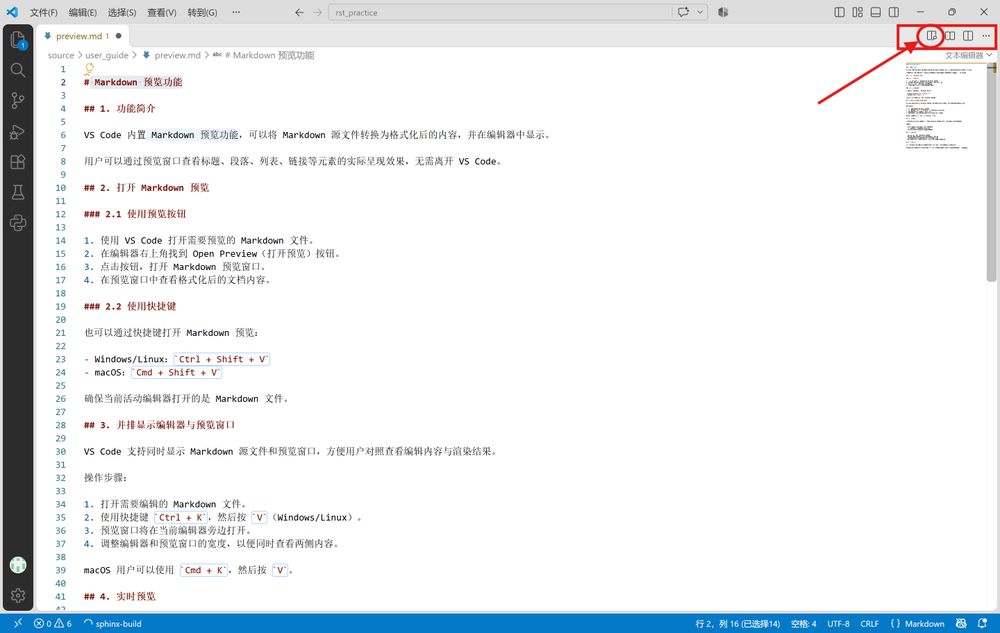
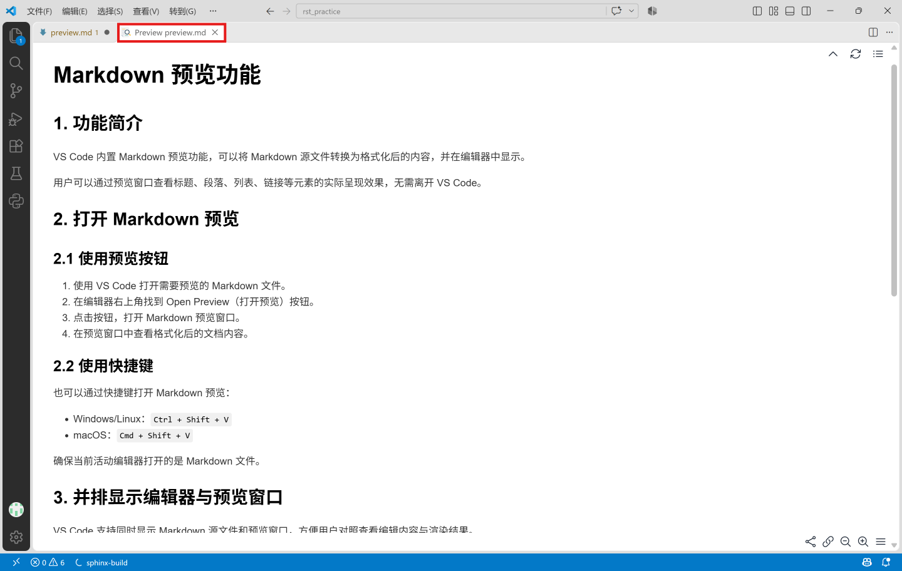
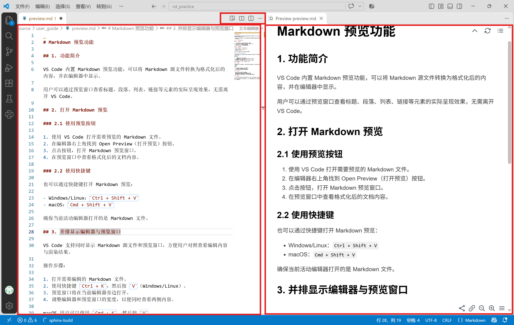
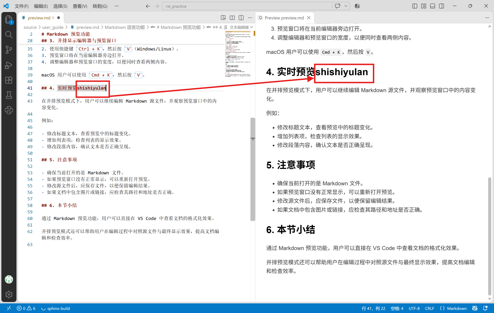

# Markdown 预览功能

## 1. 功能简介

VS Code 内置 Markdown 预览功能，可以将 Markdown 源文件转换为格式化后的内容，并在编辑器中显示。

用户可以通过预览窗口查看标题、段落、列表、链接等元素的实际呈现效果，无需离开 VS Code。

---

## 2. 打开 Markdown 预览

### 2.1 使用预览按钮

1. 使用 VS Code 打开需要预览的 Markdown 文件。
2. 在编辑器右上角找到 Open Preview (打开预览) 按钮。位置如下图所示。

<small>图 1：VS Code 编辑器右上角的 Open Preview 按钮，用于打开当前 Markdown 文件的预览窗口。</small>

3. 点击按钮，打开 Markdown 预览窗口。
4. 在预览窗口中查看格式化后的文档内容。如下图。

<small>图 2：VS Code 编辑器的预览窗口可以全屏显示文档渲染结果。</small>

### 2.2 使用快捷键

也可以通过快捷键打开 Markdown 预览：

- Windows/Linux：`Ctrl + Shift + V`
- macOS：`Cmd + Shift + V`

确保当前活动编辑器打开的是 Markdown 文件。

---

## 3. 并排显示编辑器与预览窗口

VS Code 支持同时显示 Markdown 源文件和预览窗口，方便用户对照查看编辑内容与渲染结果。

<small>图 3：Markdown 源文件与预览窗口并排显示。左侧为 Markdown 编辑区域，右侧为渲染后的文档内容，便于对照检查文本格式与排版效果。</small>

操作步骤：

1. 打开需要编辑的 Markdown 文件。
2. 使用快捷键 `Ctrl + K`，然后按 `V` (Windows/Linux) 。
3. 预览窗口将在当前编辑器旁边打开。
4. 调整编辑器和预览窗口的宽度，以便同时查看两侧内容。

macOS 用户可以使用 `Cmd + K`，然后按 `V`。

---

## 4. 实时预览

在并排预览模式下，用户可以继续编辑 Markdown 源文件，并观察预览窗口中的内容变化，可用于检查标题、段落及列表等元素的实际显示效果。

<small>图 4：在 Markdown 编辑区域修改文档标题后，预览窗口同步更新。</small>

---

## 5. 注意事项

- 确保当前打开的是 Markdown 文件。
- 如果预览窗口没有正常显示，可以重新打开预览。
- 修改源文件后，应保存文件，以便保留编辑结果。
- 如果文档中包含图片或链接，应检查其路径和地址是否正确。

---

## 6. 本节小结

通过 Markdown 预览功能，用户可以直接在 VS Code 中查看文档的格式化效果。

并排预览模式还可以帮助用户在编辑过程中对照源文件与最终显示效果，提高文档编辑和检查效率。
